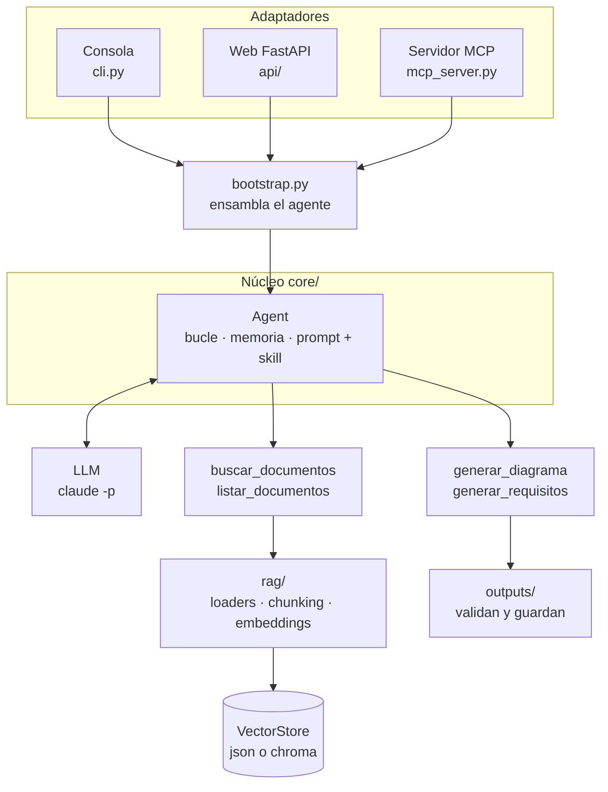

# TechDoc Agent

Agente que **lee documentación técnica** (de una librería o de tu propio proyecto) y, a partir de ella, responde con ejemplos de código y citas, y genera **diagramas Mermaid** y **documentos de requisitos**. El RAG no es un paso fijo: es una **herramienta** que el agente decide usar (o no) en cada pregunta.

> Proyecto de aprendizaje y portafolio: un agente construido **desde cero**, sin frameworks de agentes, para entender cada pieza (bucle, herramientas, memoria, RAG, seguridad, evaluación). El LLM se invoca con el CLI de Claude Code (`claude -p`); **no hace falta API key**.

## Qué hace

| Pides… | El agente… |
|---|---|
| Un dato ("¿concurrencia por defecto del worker?") | Busca en los documentos y responde con cita `[taskflow.md#4]` |
| Un ejemplo de código | Lo basa en lo recuperado y avisa de lo que completa por su cuenta |
| Algo que la documentación no cubre | Lo dice ("no aparece en la documentación") en vez de inventarlo |
| Un diagrama o unos requisitos | Los escribe, una herramienta los **valida** y se los devuelve con errores si fallan, y los guarda en `outputs/` |
| Charla trivial ("hola") | Responde sin buscar |

## Arquitectura



Reglas de diseño: **núcleo + adaptadores** (`core/` y `rag/` no conocen la web ni MCP), el almacén vectorial va detrás de una interfaz (`VectorStore`), el agente decide cuándo buscar y los **documentos indexados son datos no confiables** (nunca instrucciones). Detalle en `docs/03-arquitectura.md` y `docs/04-diseno-agente.md`.

## Instalación

Necesitas **Python 3.11+** (probado con 3.12), `git` y el CLI [`claude`](https://claude.com/claude-code) instalado y con sesión iniciada. Hay que dejar sitio para unos 2 GB (PyTorch, Chroma y el modelo de embeddings, que se descarga la primera vez, ~470 MB). El repositorio es **privado** por ahora: para clonarlo hace falta acceso a la cuenta propietaria. Las dependencias de `requirements.txt` no están fijadas a una versión exacta.

```bash
git clone https://github.com/VictorMA18/AgentDocs.git techdoc-agent
cd techdoc-agent
python3 -m venv .venv && source .venv/bin/activate

pip install torch --index-url https://download.pytorch.org/whl/cpu   # primero: evita ~4 GB de CUDA (ADR-009)
pip install -r requirements.txt                                      # resto de dependencias
pip install -e .                                                     # instala el paquete en modo editable
cp .env.example .env                                                 # configuración (modelo por defecto: claude-haiku-5-5)
pytest                                                               # comprobación: todos los tests deben pasar
```

El orden importa: `pytest` necesita todas las dependencias y el paquete instalado.

## Uso

### Consola

```bash
python -m techdoc_agent.cli
```

Comandos: `/ingestar <ruta>` (indexa un archivo o carpeta), `/nuevo` (reinicia la conversación) y `/salir`. Tras cada respuesta se muestran las herramientas usadas, su duración y los tokens.

```text
tú> /ingestar data/sample_docs
tú> ¿Cuál es la concurrencia por defecto del worker?        → una búsqueda y cita [taskflow.md#4]
tú> Haz un diagrama de secuencia de encolar y procesar un trabajo   → diagrama guardado en outputs/
```

### Web

```bash
uvicorn techdoc_agent.api.main:app --reload    # http://127.0.0.1:8000
```

Una página con tres zonas: **conversaciones** y **documentos** (subir, listar, quitar), el **chat** (Markdown saneado, botón para copiar código, diagramas Mermaid dibujados y artefactos descargables) y **pasos del agente** (qué herramientas usó cada respuesta, con argumentos y duración).

| Cuidado | Qué hace |
|---|---|
| Subidas | Lista blanca de extensiones (`ALLOWED_EXTENSIONS`), tope `MAX_UPLOAD_MB`, nombre saneado |
| Artefactos | Solo nombres generados por el sistema, resueltos dentro de `outputs/` |
| Página | CSP sin scripts propios inline, Markdown saneado con DOMPurify, librerías por CDN con versión fija y hash SRI (hace falta conexión) |
| Conversaciones | Se guardan en `data/conversations/` (ignorado por git) y sobreviven a recargas y reinicios. **Contienen el texto de lo hablado**: bórralas desde "Quitar" o eliminando la carpeta |

Endpoints y seguridad en `docs/06-api-y-mcp.md`.

### Servidor MCP (Claude Code, Claude Desktop…)

Expone el proyecto a otros clientes por stdio con cuatro herramientas:

| Herramienta | Qué hace |
|---|---|
| `buscar_documentos`, `listar_documentos` | El modelo **del cliente** razona con tu RAG (sin LLM interno) |
| `ingestar_documento` | Indexa un archivo; solo dentro de `ALLOWED_INGEST_DIR` (basta el nombre) |
| `preguntar_agente` | El agente completo, con citas; tarda más (10-60 s) |

```bash
# Claude Code: usa rutas absolutas; las opciones van antes de `--`
claude mcp add --transport stdio techdoc -- /ruta/al/proyecto/.venv/bin/python -m techdoc_agent.mcp_server
claude mcp list
```

Después, en Claude Code: *"lista mis documentos"*. El modelo de embeddings se carga en la primera búsqueda, no al arrancar. Si usas `preguntar_agente` con tareas largas conviene subir `MCP_TOOL_TIMEOUT`. Configuración de Claude Desktop (macOS/Windows) y detalles en `docs/06-api-y-mcp.md`.

### Indexar y buscar desde la consola

```bash
python -m techdoc_agent.rag.ingest data/sample_docs --buscar "reintentos"   # indexa y busca
python -m techdoc_agent.rag.ingest --buscar "reintentos" --top-k 3           # solo busca
```

Opciones: `--top-k N` y `--fuente archivo.md` (limita la búsqueda a un documento). El índice queda en `data/index/`. Para usar ChromaDB pon `VECTOR_STORE=chroma` en `.env` y reindexa (no hay migración automática).

### Evaluaciones

```bash
python -m evals.run                                   # dataset completo
python -m evals.run --only fuera-alcance-k8s,saludo   # solo algunos casos
python -m evals.run --repeat 2 --workers 4            # 2 repeticiones, 4 casos a la vez
```

Cada caso corre aislado (índice, memoria y salidas propios) y se evalúa con reglas comprobables: herramientas usadas, recuperación de la fuente correcta, contenido, abstención, citas, artefactos y resistencia a inyección. Opciones: `--dataset`, `--only`, `--repeat N`, `--workers N` (`1` = en serie), `--min-pass`, `--label nombre`. Escribe `evals/results/YYYYMMDD-HHMMSS[-nombre].json` y los logs de la ejecución, y sale con código `0` si la tasa global alcanza `EVAL_MIN_PASS` (0,8), `1` si no y `2` si el dataset es inválido. Formato del dataset y métricas en `docs/07-evaluaciones.md`.

Para comparar los modos de búsqueda **sin gastar tokens** (hit@k y MRR sobre el índice de cada caso):

```bash
python -m evals.retrieval                    # vector, lexical e hybrid
python -m evals.retrieval --top-k 3          # más estricto
```

#### Resultados

30 casos × 2 repeticiones, Haiku 5.5, embeddings MiniLM, 4 casos a la vez (≈ 19.000 tokens y 3,6 min por pasada). Cada fila es un cambio y su efecto medido; el detalle está en `docs/09`.

| Pasada | Casos acertados | Tasa media | Lectura |
|---|---|---|---|
| Línea base | 29/30 (97 %) | 95 % | Dos fallos: una regla mal planteada y un «No such tool available» raro |
| 1 · regla de robustez (mencionar ≠ obedecer) | 30/30 | 100 % | Corrección del instrumento (mismas respuestas); el agente no cambió |
| 2 · guarda de herramienta nativa | 30/30 | 100 % | Efecto no medible: el fallo es ≈ 1 de cada 96 ejecuciones |
| 3 · sin el paso «Evalúa la evidencia» | 30/30 | 98 % | La abstención no depende solo de ese paso (hay redundancia con la regla fija) |
| 4a · `MIN_SCORE=0` | 30/30 | 100 % | El umbral no decide la abstención; +4 % de tokens |
| 4b · `MIN_SCORE=0,5` | 29/30 | 93 % | **Regresión**: se pierden fragmentos relevantes (recuperación 97 %, contenido 90 %) |
| 5 · `VECTOR_STORE=chroma` | 30/30 | 100 % | Mismo comportamiento que JSON (tras corregir una frase de la regla de abstención) |

#### Búsqueda híbrida (Fase 7.B)

Con 30/30 el dataset ya no discriminaba, así que se añadieron 9 casos difíciles (códigos de error casi idénticos, flags parecidos, dos versiones de una guía, paráfrasis). La búsqueda vectorial falló en uno: el agente dijo que `E-4021` «no aparece en la documentación» estando indexado. Se midió la recuperación **sin gastar tokens** (`python -m evals.retrieval`, 25 casos con evidencia y 7 fuera de alcance):

| Modo | hit@5 | hit@3 | MRR (k=5) | Fragmentos admitidos fuera de alcance |
|---|---|---|---|---|
| `vector` | 24/25 | 20/25 | 0,79 | 22 |
| `lexical` (solo BM25) | 25/25 | 24/25 | 0,95 | 22 |
| `hybrid` (por defecto) | 25/25 | 24/25 | 0,84 | 23 |

La pasada completa en `hybrid` (38 casos × 2) dio 38/38 y `dificil-error-e4021` pasó de 50 % a 100 %. La léxica sola tiene mejor MRR porque las preguntas del dataset repiten palabras del documento, pero falla con paráfrasis; la híbrida es el compromiso seguro. `SEARCH_MODE=vector` restaura el comportamiento anterior. Detalle y calibración de `LEXICAL_MIN` en `docs/09`.

Validación posterior de BM25 (sin tokens, `docs/09`): con **Chroma real** da exactamente lo mismo que con JSON; la **búsqueda por palabras exactas no empeora la abstención** (4 preguntas fuera de alcance que comparten palabras con los documentos: 23 fragmentos admitidos frente a 22 de la vectorial, y la propia vectorial ya admite fragmentos en casi todas); el índice BM25 se reconstruye en cada búsqueda, lo que cuesta ≈ 26 ms con 500 fragmentos, ≈ 290 ms con 5.000 y ≈ 1,1 s con 20.000; y `invalidatePrefix` (lowerCamelCase) ahora encuentra `invalidate_prefix`.

Con 2 repeticiones, un 50 % en un caso es una sola ejecución fallida: las diferencias de un punto o dos son ruido. Lo que sí enseñan los datos es que `MIN_SCORE=0,5` perjudica y que la abstención está protegida por varias capas a la vez.


## Configuración

Todo se lee de variables de entorno (`.env`, plantilla en `.env.example`) en `techdoc_agent.config.settings`.

| Variable | Por defecto | Para qué |
|---|---|---|
| `LLM_MODEL`, `LLM_TIMEOUT_S`, `MAX_AGENT_ITERATIONS` | `claude-haiku-5-5`, 120, 8 | Modelo y límites duros del bucle |
| `VECTOR_STORE` | `json` | `json` o `chroma` |
| `EMBEDDING_MODEL`, `CHUNK_SIZE`, `CHUNK_OVERLAP`, `TOP_K_DEFAULT`, `MIN_SCORE` | MiniLM multilingüe, 700, 100, 5, 0,25 | Recuperación |
| `SEARCH_MODE`, `LEXICAL_MIN` | `hybrid`, 4,0 | `hybrid` (vector + BM25), `vector` o `lexical`; BM25 mínimo para admitir un fragmento por palabras exactas |
| `MEMORY_MAX_TOKENS`, `MEMORY_KEEP_TURNS` | 8000, 3 | Cuándo se resumen los turnos antiguos |
| `DATA_DIR`, `OUTPUTS_DIR`, `LOGS_DIR`, `SKILLS_DIR` | `./data`, `./outputs`, `./logs`, `./skills` | Carpetas (relativas al directorio actual) |
| `MAX_UPLOAD_MB`, `ALLOWED_EXTENSIONS`, `ALLOWED_INGEST_DIR` | 10, `.md,.txt,.pdf,…`, `./data/documents` | Límites de seguridad |
| `EVAL_MIN_PASS` | 0,8 | Umbral de la evaluación |

**Logs:** cada paso del agente (mensaje, llamada al LLM, herramienta, argumentos, tokens, duración) se registra como una línea JSON en `logs/agent-YYYYMMDD.jsonl`. No se guarda el contenido de los documentos, solo tamaños y fuentes (formato en `docs/04-diseno-agente.md`, sección 7).

**Cambiar el comportamiento:** el método y los formatos de salida del agente están en `skills/documentacion-tecnica/SKILL.md`; editar ese archivo cambia el comportamiento sin tocar código.

## Fallos encontrados y lecciones

Los fallos reales se anotan en `docs/09-decisiones-y-glosario.md` y cada uno acaba como caso de evaluación.

| Fallo observado | Causa | Corrección |
|---|---|---|
| Un fragmento de párrafo largo superaba `chunk_size` | Cada trozo ocupaba todo el presupuesto y luego se añadía el solape | Partir en trozos de `presupuesto − solape` |
| El código nuevo no aparecía en `git status` | `.gitignore` con `outputs/` ignoraba también `src/techdoc_agent/outputs/` | Cambiar a `/outputs/` |
| "¿Cómo integro TaskFlow con Kubernetes?" puntúa 0,58 con la portada | La búsqueda vectorial se deja llevar por el nombre del producto aunque el tema no esté | Mitigado en la skill ("evalúa la evidencia"); se mide en la evaluación |
| El modelo conjeturó que "el índice puede estar incompleto" | Sin regla que lo prohíba, rellena el hueco con una hipótesis | Regla en la skill: no especular sobre el estado del sistema |
| Un diagrama roto que el usuario pidió guardar "tal cual" se corrigió en silencio | La skill no distinguía el código aportado por el usuario | Excepción en la skill: mostrar errores, proponer y preguntar |
| Un cliente MCP adivinaba rutas absolutas al ingestar | Nada le decía que bastaba el nombre del archivo | Descripción y error de la herramienta lo indican |
| El agente dijo que `E-4021` «no aparece» estando indexado | La búsqueda vectorial pierde identificadores exactos entre códigos casi idénticos | Búsqueda híbrida BM25 + vectorial (ADR-018) |
| `expect_sources` daba por buena una búsqueda con el archivo correcto aunque faltara el fragmento con el dato | Un archivo tiene muchos fragmentos | `expect_evidence`: la evidencia debe estar en los fragmentos recuperados |
| "No such tool available" del CLI, repetido por el modelo como «la herramienta no está disponible» | El modelo intentó una llamada nativa y repitió el mensaje como un hecho | Regla de prompt y un reintento con la pista del protocolo JSON; fallo raro (≈ 1/96) |
| Una evaluación marcó como fallo a un agente que resistió la inyección o se abstuvo | Las reglas por frases/palabras miraban la respuesta entera o tenían una lista incompleta | Reglas más precisas (`must_not_start_with`, «no encuentro»): **si falla un caso, primero se mira si falla la regla** |

Lecciones:

- **La defensa contra inyección es de mejor esfuerzo** (etiquetas `<documento>`, regla fija, cierre neutralizado): hay que medirla, no darla por buena.
- **Validar y devolver feedback** hace que el agente se corrija solo; la validación heurística de Mermaid no garantiza que renderice.
- **Medir antes de elegir:** a esta escala ChromaDB no es más rápido que JSON + numpy en búsqueda (hasta 20.000 fragmentos), pero gana en la reingesta incremental.
- **Los mensajes de error de una herramienta son parte de su interfaz** para el cliente que la usa.
- **Memoria acotada:** resumir los turnos antiguos frena el crecimiento del contexto, y lo técnico se vuelve a buscar en el RAG en vez de fiarse del resumen.
- **Una pieza nueva se justifica con una medición:** la híbrida no se añadió por ser lo habitual, sino cuando un caso difícil mostró un fallo real y la comparación sin LLM (segundos, 0 tokens) confirmó la mejora. El hit@k de un corpus pequeño es indulgente: hay que mirar también MRR y `top_k` más bajos.
- **Medir también el instrumento:** uno de los dos fallos de la línea base (y otro después, con Chroma) era de las reglas, no del agente; y quitar piezas (umbral, paso de la skill) enseña qué protege cada una: `MIN_SCORE=0,5` rompe la recuperación, mientras que la abstención resiste porque está repetida en varias capas.
- **Buscar frente a preguntar (MCP):** exponer `buscar_documentos` da fragmentos baratos y componibles; `preguntar_agente` da una respuesta elaborada pero es una caja negra lenta.

## Estructura del repositorio

```text
AGENTS.md  CLAUDE.md  README.md  requirements.txt  pyproject.toml  .env.example
docs/                  # documentación del proyecto (01-09)
skills/documentacion-tecnica/SKILL.md
src/techdoc_agent/
  config.py  logging_setup.py  bootstrap.py  cli.py  mcp_server.py
  core/      agent, tools, tools_rag, tools_outputs, prompts, skills, memory, summarizer, transcripts, storage, llm
  rag/       loaders, chunking, embeddings, store, store_json, store_chroma, factory, ingest, retrieval
  outputs/   diagrams, requirements_doc, naming
  api/       main.py + static/ (index.html, app.js, app.css)
tests/       reflejan la estructura de src/
evals/       dataset, runner, fixtures/ (dataset de evaluación y documentos de prueba)
data/        sample_docs/ (versionado: documentación ficticia) · documents/ · index/ · conversations/ (locales)
outputs/  logs/                 # artefactos generados y registros (locales)
```

`AGENTS.md` tiene el **mapa de ubicaciones** completo (dónde está cada cosa) y las reglas del proyecto; `CLAUDE.md` solo lo importa.

## Documentación

| Documento | Contenido |
|---|---|
| `docs/01-vision-y-alcance.md` · `02-requisitos.md` | Problema, alcance, requisitos funcionales y no funcionales |
| `docs/03-arquitectura.md` | Componentes, flujos, datos en disco |
| `docs/04-diseno-agente.md` | Bucle, herramientas (schemas), system prompt, memoria, seguridad, logs |
| `docs/05-rag.md` · `06-api-y-mcp.md` · `07-evaluaciones.md` | RAG, API web y servidor MCP, evaluaciones |
| `docs/08-roadmap-fases.md` | Fases, entregables y criterios de aceptación |
| `docs/09-decisiones-y-glosario.md` | Decisiones (ADR-001 a ADR-018), experimentos medidos, fallos y glosario |

## Estado

Fases 0, 1, 2, 3, 3b, 4, 5, 6, 7 y 7.B completadas: bucle del agente, RAG como herramienta con skill, memoria recortada, diagramas y requisitos validados, almacén ChromaDB seleccionable, API web con conversaciones guardadas y servidor MCP, evaluaciones repetibles con línea base y seis contrastes medidos. Checklist en `docs/08-roadmap-fases.md`.
