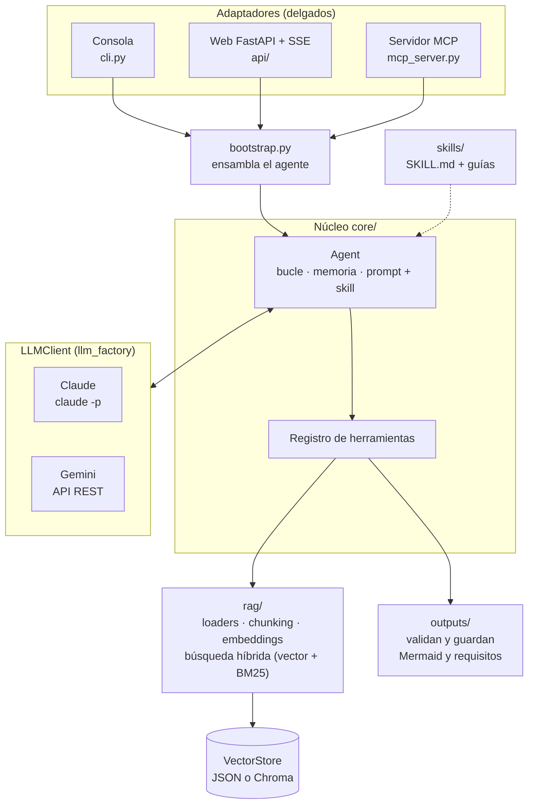
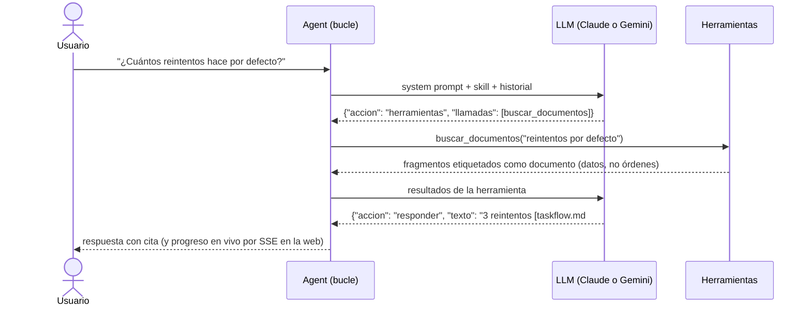

# TechDoc Agent


Agente que **lee documentación técnica** (de una librería o de tu propio proyecto) y, a partir de ella, **responde con citas y ejemplos de código**, y genera **diagramas Mermaid** y **documentos de requisitos** validados. El RAG no es un paso fijo: es una **herramienta** que el agente decide usar (o no) en cada pregunta.

<!-- Captura de la interfaz web: guarda la imagen en docs/img/web.png y descomenta la línea siguiente.

-->

## Contenido

- [Introducción](#introducción)
- [Objetivos](#objetivos)
- [Qué hace](#qué-hace)
- [Tecnologías](#tecnologías)
- [Arquitectura](#arquitectura)
- [Cómo funciona el agente](#cómo-funciona-el-agente)
- [Instalación](#instalación)
- [Uso](#uso)
- [Configuración](#configuración)
- [Evaluación y resultados](#evaluación-y-resultados)
- [Seguridad](#seguridad)
- [Estructura del repositorio](#estructura-del-repositorio)
- [Documentación](#documentación)
- [Estado y próximos pasos](#estado-y-próximos-pasos)
- [Licencia](#licencia)

## Introducción

Cuando trabajas con una librería o un proyecto grande, la respuesta suele estar en la documentación, pero repartida en muchos archivos. Un chat genérico puede responder rápido, pero **inventa** cuando no sabe, y no te dice de dónde sale lo que afirma.

TechDoc Agent indexa tus documentos (Markdown, texto, PDF y código) y responde **solo con lo que encuentra en ellos**, citando el fragmento exacto (`[taskflow.md#4]`). Si la documentación no cubre la pregunta, lo dice en vez de inventar. Además, convierte esa documentación en artefactos útiles: diagramas de secuencia, de clases o de flujo, y requisitos funcionales con criterios de aceptación.

Es un **proyecto de aprendizaje y portafolio**: el agente está construido **desde cero, sin frameworks de agentes** (nada de LangChain, LlamaIndex, etc.), para entender y poder explicar cada pieza: el bucle, las herramientas, la memoria, el RAG, la seguridad y la evaluación.

## Objetivos

- **Entender cómo funciona un agente por dentro:** bucle escrito a mano, protocolo de herramientas propio y memoria con resumen.
- **RAG como herramienta, no como pipeline:** el modelo decide cuándo buscar; un "hola" no dispara una búsqueda.
- **Respuestas verificables:** citas a los fragmentos usados y abstención cuando no hay evidencia.
- **Salidas validadas:** las herramientas comprueban los diagramas y los requisitos y devuelven los errores al modelo para que se corrija.
- **Medir antes de decidir:** cada cambio importante se justifica con una evaluación repetible (46 casos con reglas comprobables).
- **Un núcleo, varias interfaces:** el mismo agente se usa desde la consola, una web y un servidor MCP.

## Qué hace

| Pides… | El agente… |
|---|---|
| Un dato ("¿concurrencia por defecto del worker?") | Busca en los documentos y responde con la cita `[taskflow.md#4]` |
| Un ejemplo de código | Lo basa en lo recuperado y avisa de lo que completa por su cuenta |
| Algo que la documentación no cubre | Lo dice ("no aparece en la documentación") en vez de inventarlo |
| Un diagrama o unos requisitos | Los escribe; una herramienta los **valida**, le devuelve los errores si fallan y los guarda en `outputs/` |
| Algo ambiguo | Pregunta qué quieres decir antes de buscar a ciegas |
| Charla trivial ("hola") | Responde sin buscar |

Herramientas que puede usar el modelo:

| Herramienta | Para qué |
|---|---|
| `buscar_documentos` | Búsqueda híbrida (semántica + palabras exactas) en los documentos indexados |
| `listar_documentos` | Qué documentos hay indexados |
| `generar_diagrama` | Valida y guarda un diagrama Mermaid |
| `generar_requisitos` | Valida y guarda un documento de requisitos (RF/RNF con criterios de aceptación) |
| `cargar_guia` | Carga bajo demanda las instrucciones detalladas de diagramas o requisitos |

## Tecnologías

| Área | Tecnología | Por qué |
|---|---|---|
| Lenguaje | Python 3.11+ | Tipado, `dataclasses` y ecosistema de IA |
| LLM | CLI de Claude Code (`claude -p`, Haiku 5.5) **o** API de Gemini (`gemini-3.5-flash-lite`) | Claude sin API key; Gemini como alternativa con clave gratuita. Se elige con `LLM_PROVIDER` |
| Agente | Bucle propio + protocolo JSON de herramientas | Sin frameworks: se entiende y se controla cada paso |
| Embeddings | `sentence-transformers` (MiniLM multilingüe, local) | Gratis, sin red y funciona en español |
| Búsqueda | Vectorial + BM25 propio fusionados con RRF | La vectorial entiende paráfrasis; BM25 encuentra identificadores exactos como `E-4021` |
| Almacén vectorial | JSON + `numpy` (por defecto) o ChromaDB | Detrás de una interfaz `VectorStore`: se cambia con una variable |
| Documentos | `pypdf` y lectores propios | Markdown, texto, PDF y código fuente |
| Web | FastAPI + `uvicorn` + HTML/JS sin framework, SSE para el progreso | Interfaz ligera; el progreso del agente se ve en vivo |
| Integración | `mcp` 2.x (SDK oficial) | Usa el agente desde Claude Code, Claude Desktop u otros clientes MCP |
| Diagramas | Mermaid; validación real opcional con `mermaid-cli` | Comprueba que el diagrama se dibuja de verdad |
| Pruebas | `pytest` (597 tests) + evaluaciones propias (`evals/`) | Lógica sin red ni modelo; comportamiento con el modelo real |
| Registros | JSONL en `logs/` | Cada paso del agente queda registrado (herramienta, argumentos, tokens, duración) |

## Arquitectura



Reglas de diseño (no negociables):

1. **Núcleo + adaptadores:** `core/` y `rag/` no conocen la web ni MCP. Las interfaces solo traducen y llaman al núcleo.
2. **Todo detrás de interfaces:** el LLM (`LLMClient`) y el almacén (`VectorStore`) se pueden cambiar sin tocar el agente.
3. **El agente decide:** nunca se busca automáticamente antes de llamar al modelo.
4. **Los documentos indexados son datos no confiables:** su contenido nunca se trata como instrucciones.
5. **Todo se registra y todo tiene límites:** máximo de iteraciones, tiempo por llamada, tamaño y tipo de archivo.

**Skill ≠ conocimiento.** La *skill* (`skills/documentacion-tecnica/`) dice **cómo** trabajar: cuándo buscar, cómo citar, cuándo abstenerse. El **conocimiento** vive en los documentos indexados. Cambiar el comportamiento del agente es editar la skill, sin tocar código.

Detalle en [`docs/03-arquitectura.md`](docs/03-arquitectura.md) y [`docs/04-diseno-agente.md`](docs/04-diseno-agente.md).

## Cómo funciona el agente

En cada turno el modelo responde con un JSON: o **pide herramientas** o **da la respuesta final**. El bucle ejecuta las herramientas, le devuelve los resultados y repite hasta la respuesta, con un máximo de iteraciones.



- **Protocolo propio:** las herramientas se piden con un JSON definido por nosotros (`accion`, `llamadas`, `texto`), no con el *tool use* nativo del proveedor. Por eso el mismo agente funciona con Claude y con Gemini.
- **Memoria acotada:** cuando la conversación crece, los turnos antiguos se resumen; lo técnico se vuelve a buscar en vez de fiarse del resumen.
- **Validar y devolver feedback:** si un diagrama tiene errores, la herramienta los devuelve y el modelo lo corrige en la siguiente vuelta.
- **Skill con divulgación progresiva:** las instrucciones largas (diagramas y requisitos) solo se cargan cuando hacen falta, lo que ahorra tokens.

## Instalación

Necesitas **Python 3.11+** (probado con 3.12), `git` y **uno** de estos proveedores de LLM:

- el CLI [`claude`](https://claude.com/claude-code) instalado y con sesión iniciada (por defecto, sin API key), o
- una clave de la API de Gemini, que se crea gratis en Google AI Studio.

Deja unos 2 GB libres: PyTorch, Chroma y el modelo de embeddings, que se descarga la primera vez (~470 MB).

```bash
git clone https://github.com/VictorMA18/AgentDocs.git techdoc-agent
cd techdoc-agent
python3 -m venv .venv && source .venv/bin/activate

pip install torch --index-url https://download.pytorch.org/whl/cpu   # primero: evita ~4 GB de CUDA
pip install -r requirements.txt
pip install -e .
cp .env.example .env                                                 # configuración
pytest                                                               # todos los tests deben pasar
```

**Para usar Gemini** en vez de Claude, añade en `.env` (nunca en el código ni en git):

```bash
LLM_PROVIDER=gemini
GEMINI_API_KEY=tu-clave
```

## Uso

### Consola

```bash
python -m techdoc_agent.cli
```

```text
tú> /ingestar data/sample_docs
tú> ¿Cuál es la concurrencia por defecto del worker?               → una búsqueda y la cita [taskflow.md#4]
tú> Haz un diagrama de secuencia de encolar y procesar un trabajo   → diagrama validado y guardado en outputs/
```

Comandos: `/ingestar <ruta>` (indexa un archivo o una carpeta), `/nuevo` (reinicia la conversación) y `/salir`. Tras cada respuesta se muestran las herramientas usadas, su duración y los tokens.

### Web

```bash
uvicorn techdoc_agent.api.main:app --reload    # http://127.0.0.1:8000
```

<!-- Captura del chat con un diagrama: docs/img/chat-diagrama.png

-->

La página tiene tres zonas:
- **Conversaciones y documentos:** subir, listar y quitar documentos; las conversaciones se guardan y sobreviven a reinicios.
- **Chat:** Markdown saneado, botón para copiar código, diagramas Mermaid dibujados y artefactos descargables. Mientras el agente trabaja muestra su progreso en vivo ("Buscando en la documentación…").
- **Pasos del agente:** qué herramientas usó cada respuesta, con argumentos y duración.

### Servidor MCP (Claude Code, Claude Desktop…)

Expone el proyecto a otros clientes por stdio con cuatro herramientas: `buscar_documentos` y `listar_documentos` (el modelo del cliente razona con tu RAG), `ingestar_documento` y `preguntar_agente` (el agente completo, con citas).

```bash
claude mcp add --transport stdio techdoc -- /ruta/al/proyecto/.venv/bin/python -m techdoc_agent.mcp_server
```

Después, en Claude Code: *"lista mis documentos"*. La configuración de Claude Desktop está en [`docs/06-api-y-mcp.md`](docs/06-api-y-mcp.md).

### Otros comandos

```bash
python -m techdoc_agent.rag.ingest data/sample_docs --buscar "reintentos"   # indexar y buscar sin LLM
python -m evals.run --repeat 2 --workers 4                                # evaluación con el modelo
python -m evals.retrieval                                                 # comparar modos de búsqueda (0 tokens)
```

**Validación real de Mermaid (opcional):** `cd tools/mermaid && npm install` y `MERMAID_VALIDATE=cli` en `.env`. Necesita Node y descarga Chromium (≈ 170 MB). Si `mmdc` no arranca, el agente sigue con la validación heurística.

## Configuración

Todo se configura con variables de entorno (`.env`; plantilla en [`.env.example`](.env.example)). Las principales:

| Variable | Por defecto | Para qué |
|---|---|---|
| `LLM_PROVIDER` | `claude` | `claude` (CLI de Claude Code, sin clave) o `gemini` (API de Gemini) |
| `LLM_MODEL`, `LLM_TIMEOUT_S`, `MAX_AGENT_ITERATIONS` | `claude-haiku-5-5`, 120, 8 | Modelo de Claude y límites duros del bucle |
| `GEMINI_API_KEY`, `GEMINI_MODEL`, `GEMINI_THINKING_LEVEL` | vacía, `gemini-3.5-flash-lite`, vacío | Solo con `LLM_PROVIDER=gemini`; la clave es un secreto |
| `VECTOR_STORE` | `json` | `json` o `chroma` |
| `SEARCH_MODE` | `hybrid` | `hybrid` (vector + BM25), `vector` o `lexical` |
| `EMBEDDING_MODEL`, `CHUNK_SIZE`, `CHUNK_OVERLAP`, `TOP_K_DEFAULT`, `MIN_SCORE` | MiniLM multilingüe, 700, 100, 5, 0,25 | Recuperación |
| `LEXICAL_MIN`, `LEXICAL_RESERVE` | 4,0, 3 | Ajuste fino de la búsqueda por palabras exactas |
| `MERMAID_VALIDATE` | `heuristic` | `heuristic` o `cli` (mermaid-cli) |
| `MEMORY_MAX_TOKENS`, `MEMORY_KEEP_TURNS` | 8000, 3 | Cuándo se resumen los turnos antiguos |
| `MAX_UPLOAD_MB`, `ALLOWED_EXTENSIONS`, `ALLOWED_INGEST_DIR` | 10, `.md,.txt,.pdf,…`, `./data/documents` | Límites de seguridad |

**Gemini con el plan gratuito:** `gemini-3.5-flash-lite` permite 15 peticiones por minuto y 500 al día, y cada pregunta gasta de 2 a 4. Ante el límite por minuto el cliente espera y reintenta; si se agota la cuota diaria falla enseguida con un mensaje claro. La cuota se reinicia a medianoche, hora del Pacífico.

La lista completa está en `.env.example`.

## Evaluación y resultados

El comportamiento se mide con un **dataset de 46 casos** (`evals/dataset.jsonl`) que se ejecutan con el modelo real y se evalúan con **reglas comprobables**: herramientas usadas, recuperación del fragmento correcto, contenido, citas, abstención, artefactos válidos y resistencia a inyección. Cada caso corre aislado y se repite para separar el ruido de los cambios reales.

| Medición | Resultado |
|---|---|
| Pasada completa (46 casos × 2, Claude Haiku 5.5) | **46/46 (100 %)**, abstención 16/16, ≈ 17.000 tokens por ejecución |
| Muestra de 15 casos × 2 con **Claude** | 15/15 · 16.161 tokens · 11,7 s por ejecución |
| La misma muestra con **Gemini 3.5 Flash Lite** | 15/15 · 6.815 tokens · 9,3 s por ejecución |
| Búsqueda híbrida frente a vectorial (4 casos clave × 5) | 20/20 frente al 85 %; encuentra códigos exactos como `E-4021` |
| Inyección en un documento real (instrucciones ocultas) | 0/6 obedecidas; 5/6 avisan al usuario |
| Diagramas rotos detectados con `mermaid-cli` | 7/7 (la heurística detectaba 0/7) |
| Prueba con documentación real | httpx: 14/14 preguntas correctas · manual PDF de `requests`: destapó un fallo de la fusión híbrida, corregido (5/5 después) |

Algunas lecciones del proceso:

- **Medir también el instrumento:** varios "fallos" eran de las reglas de evaluación, no del agente.
- **Una pieza nueva se justifica con datos:** la búsqueda híbrida se añadió cuando un caso real falló y la comparación sin LLM (0 tokens) confirmó la mejora.
- **Probar con documentos reales:** un PDF de verdad destapó un fallo que 26 casos ficticios no veían.
- **"0 activaciones" no prueba que una protección sobre:** se retiró una guarda que nunca saltaba, el fallo reapareció y se restauró.

Las tablas de cada pasada están en [`docs/07-evaluaciones.md`](docs/07-evaluaciones.md); los experimentos, los fallos encontrados y las lecciones, en [`docs/09-decisiones-y-glosario.md`](docs/09-decisiones-y-glosario.md).

## Seguridad

| Riesgo | Mitigación |
|---|---|
| Inyección de instrucciones en los documentos | Fragmentos en etiquetas `<documento>` con el cierre neutralizado, regla fija en el prompt y medición con documentos envenenados |
| Subidas maliciosas | Lista blanca de extensiones, tamaño máximo y nombres saneados por el sistema |
| Acceso a archivos fuera de lugar | Artefactos solo con nombres generados dentro de `outputs/`; la ingesta por MCP, limitada a `ALLOWED_INGEST_DIR` |
| XSS en la web | CSP sin scripts inline, Markdown saneado con DOMPurify, librerías con hash SRI |
| Claves | Solo en `.env` (fuera de git). La clave de Gemini viaja en una cabecera y nunca aparece en logs ni errores |
| Bucles sin fin o llamadas colgadas | Máximo de iteraciones y tiempo máximo por llamada al LLM |

La defensa contra la inyección es de **mejor esfuerzo**: por eso se mide en la evaluación en vez de darla por buena. Detalle en [`docs/04-diseno-agente.md`](docs/04-diseno-agente.md) (sección Seguridad).

## Estructura del repositorio

```text
src/techdoc_agent/
  core/        bucle del agente, herramientas, memoria, prompt, skill, clientes LLM (Claude, Gemini)
  rag/         lectura, chunking, embeddings, búsqueda híbrida, almacenes JSON y Chroma, ingesta
  outputs/     validación y guardado de diagramas y requisitos
  api/         web FastAPI + static/ (HTML, JS, CSS)
  cli.py  mcp_server.py  bootstrap.py  config.py
skills/documentacion-tecnica/   SKILL.md + guias/ (cómo trabaja el agente)
evals/         dataset, runner, reglas y comparación de búsqueda
tests/         tests unitarios y de integración (reflejan src/)
docs/          documentación del proyecto (01-09)
data/          sample_docs/ (documentación de ejemplo) · documents/ · index/ · conversations/ (locales)
tools/mermaid/ mermaid-cli opcional
```

[`AGENTS.md`](AGENTS.md) tiene el **mapa de ubicaciones** completo (dónde está cada cosa) y las reglas del proyecto.

## Documentación

| Documento | Contenido |
|---|---|
| [`01-vision-y-alcance`](docs/01-vision-y-alcance.md) · [`02-requisitos`](docs/02-requisitos.md) | Problema, alcance, requisitos funcionales y no funcionales |
| [`03-arquitectura`](docs/03-arquitectura.md) | Componentes, flujos y datos en disco |
| [`04-diseno-agente`](docs/04-diseno-agente.md) | Bucle, herramientas (schemas), system prompt, memoria, seguridad y logs |
| [`05-rag`](docs/05-rag.md) | Ingesta, chunking, embeddings, almacenes y búsqueda híbrida |
| [`06-api-y-mcp`](docs/06-api-y-mcp.md) | Endpoints, interfaz web y servidor MCP |
| [`07-evaluaciones`](docs/07-evaluaciones.md) | Dataset, reglas, runner y resultados |
| [`08-roadmap-fases`](docs/08-roadmap-fases.md) | Fases, entregables y criterios de aceptación |
| [`09-decisiones-y-glosario`](docs/09-decisiones-y-glosario.md) | Decisiones (ADR-001 a ADR-024), experimentos, fallos, lecciones y glosario |

## Estado y próximos pasos

**Completado:**
- **Fases 0 a 8:** bucle del agente, RAG como herramienta con skill, memoria con resumen, diagramas y requisitos validados, ChromaDB seleccionable, web con conversaciones guardadas, servidor MCP, evaluaciones repetibles, búsqueda híbrida, prueba con documentos reales, progreso en vivo, skill con divulgación progresiva y validación real de Mermaid.
- **Extra:** Gemini como proveedor alternativo del LLM.

**Siguiente — Fase 9:** elegir el proveedor del LLM (Claude o Gemini) desde la interfaz web, sin reiniciar el servidor y guardando la elección en cada conversación. Detalle en [`docs/08-roadmap-fases.md`](docs/08-roadmap-fases.md).

## Licencia

[MIT](LICENSE) © 2026 VictorMA18. Las dependencias y el modelo de embeddings (que se descarga aparte) tienen sus propias licencias.
