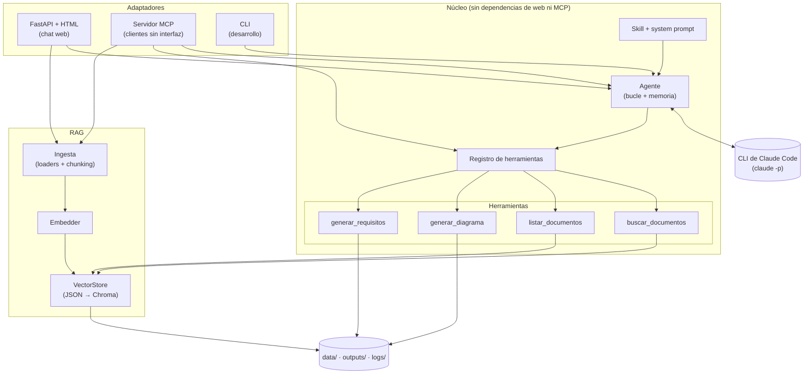
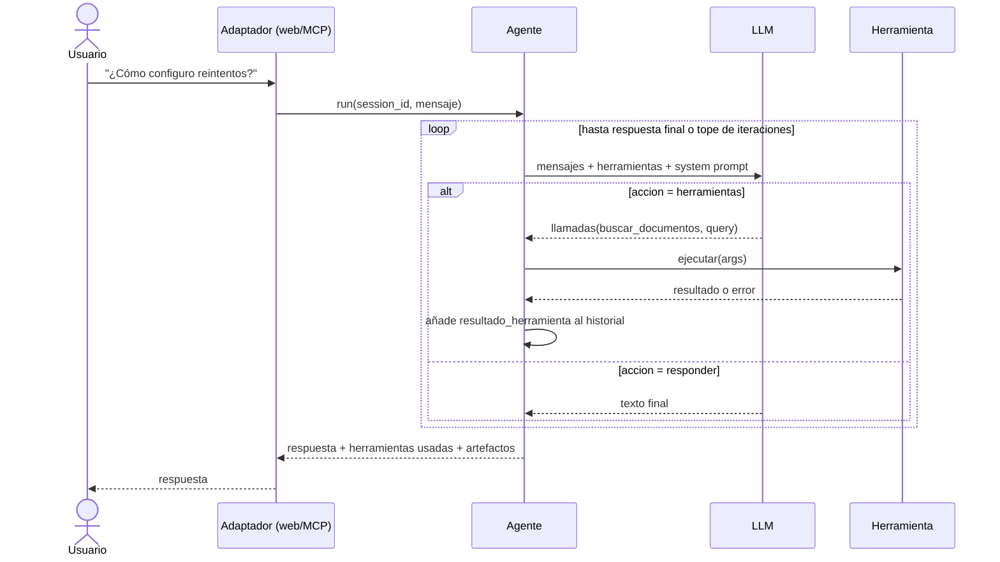
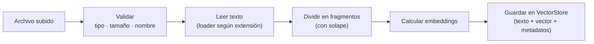
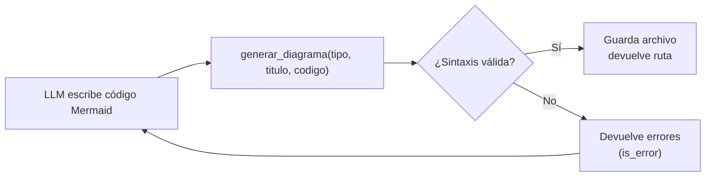

# 03 · Arquitectura

## Principio: un núcleo, dos adaptadores

El agente, el RAG y las herramientas se escriben **una vez** en el núcleo. FastAPI (web) y MCP (otros clientes) son adaptadores delgados que solo traducen entrada/salida.



## Flujo 1 · Un turno de conversación



## Flujo 2 · Ingesta de un documento



## Flujo 3 · Herramienta con retroalimentación (diagramas)



## Decisiones de diseño clave
| Tema | Decisión | Motivo |
|---|---|---|
| Frameworks de agentes | Ninguno | Entender el bucle; evitar cajas negras |
| RAG | Herramienta del agente | El LLM decide cuándo y con qué consulta buscar |
| Almacén vectorial | Interfaz `VectorStore`; JSON+numpy → Chroma | Aprender el mecanismo y luego usar una librería |
| Embeddings | Locales, multilingües | Sin costo ni API key adicional; el contenido suele estar en español |
| Memoria | En memoria por `session_id`; los turnos antiguos se resumen (ADR-011) | Controla el contexto enviado en cada llamada; la persistencia queda para después |
| Frontend | HTML + JS puro | El foco es el agente, no el frontend |
| Diagramas | El LLM escribe Mermaid; la herramienta valida | El feedback de errores permite que el agente se autocorrija |

## Estructura de carpetas
Ver `AGENTS.md`, secciones "Mapa de ubicaciones" y "Estructura objetivo".

## Datos en disco
```
data/
  documents/      # archivos originales subidos
  index/          # índice vectorial (index.json o chroma/)
outputs/          # diagramas y documentos de requisitos generados
logs/             # agent-YYYYMMDD.jsonl
```
Todo lo anterior va en `.gitignore`, excepto `data/sample_docs/`.
