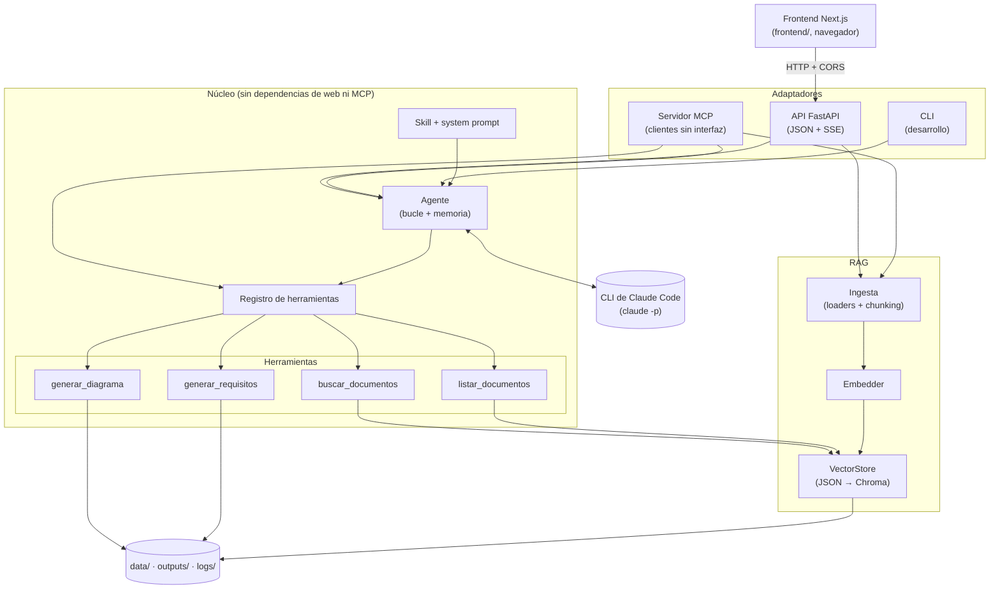
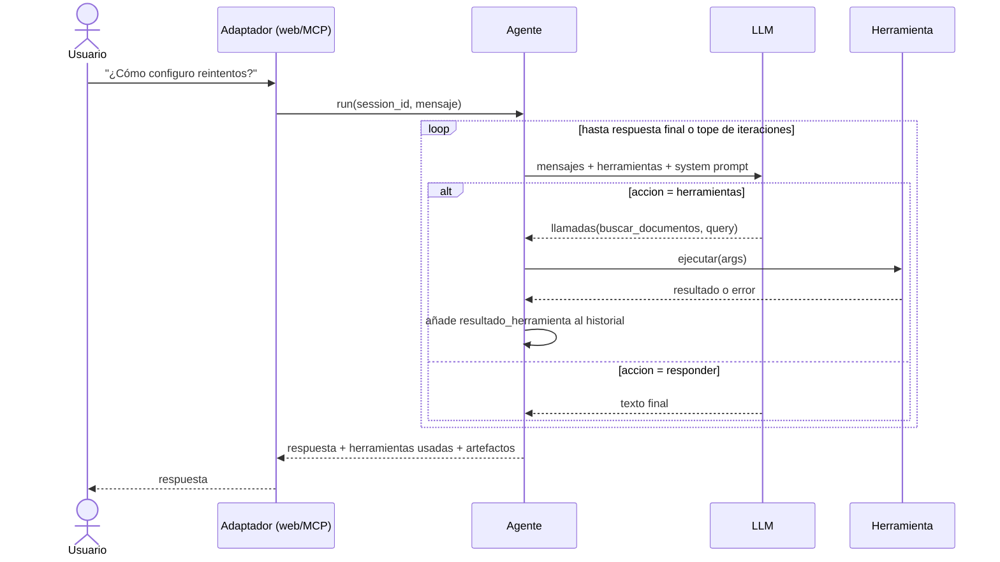
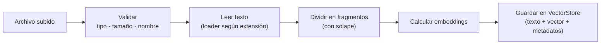
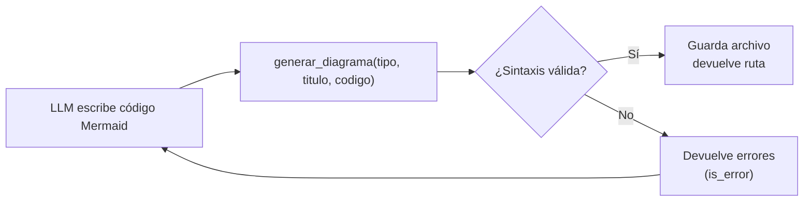

# 03 · Arquitectura

## Principio: un núcleo, dos adaptadores

El agente, el RAG y las herramientas se escriben **una vez** en el núcleo. FastAPI (API para la interfaz web) y MCP (otros clientes) son adaptadores delgados que solo traducen entrada/salida; el frontend Next.js es una aplicación aparte que solo habla con la API.



## Flujo 1 · Un turno de conversación



## Flujo 2 · Ingesta de un documento



## Flujo 3 · Herramienta con retroalimentación (diagramas)



## Decisiones de diseño clave
| Tema | Decisión | Motivo |
|---|---|---|
| Frameworks de agentes | Ninguno | Entender el bucle; evitar cajas negras |
| RAG | Herramienta del agente | El LLM decide cuándo y con qué consulta buscar |
| Almacén vectorial | Interfaz `VectorStore`; JSON+numpy → Chroma | Aprender el mecanismo y luego usar una librería |
| Embeddings | Locales, multilingües | Sin costo ni API key adicional; el contenido suele estar en español |
| Memoria | Por `session_id`; los turnos antiguos se resumen (ADR-011); en disco si el adaptador lo pide (la web, ADR-015) | Controla el contexto enviado en cada llamada y permite retomar una conversación tras reiniciar |
| Frontend | Next.js + TanStack Query + Zustand + Zod + shadcn/ui (Fase 9.B; antes HTML + JS puro) | Aplicación aparte que solo habla con la API; separa estado del servidor y de la interfaz (ADR-026) |
| Diagramas | El LLM escribe Mermaid; la herramienta valida | El feedback de errores permite que el agente se autocorrija |

## Estructura de carpetas
Desde la Fase 9 (ADR-025) el repositorio tiene dos partes: **`backend/`** (todo el código Python: núcleo, RAG, salidas, API, CLI, MCP, tests, evaluaciones, skill y datos) y **`frontend/`** (la interfaz web en Next.js, Fase 9.B, ADR-026; detalle en `docs/06`, sección C). La documentación (`docs/`) y las reglas (`AGENTS.md`) quedan en la raíz. Las rutas de este documento que empiezan por `data/`, `outputs/`, `src/` o `skills/` son relativas a `backend/`. El frontend es otro adaptador más: solo habla con la API HTTP, nunca con el núcleo.

Detalle en `AGENTS.md`, secciones "Mapa de ubicaciones" y "Estructura objetivo".

## Datos en disco
```
data/
  documents/      # archivos originales subidos
  conversations/  # <id>.memory.json (memoria del agente) y <id>.turns.json (lo que muestra la página)
  index/          # índice vectorial (index.json + vectors.npy, o chroma/ según VECTOR_STORE)
outputs/          # diagramas y documentos de requisitos generados
logs/             # agent-YYYYMMDD.jsonl
```
Todo lo anterior va en `.gitignore`, excepto `data/sample_docs/`.
